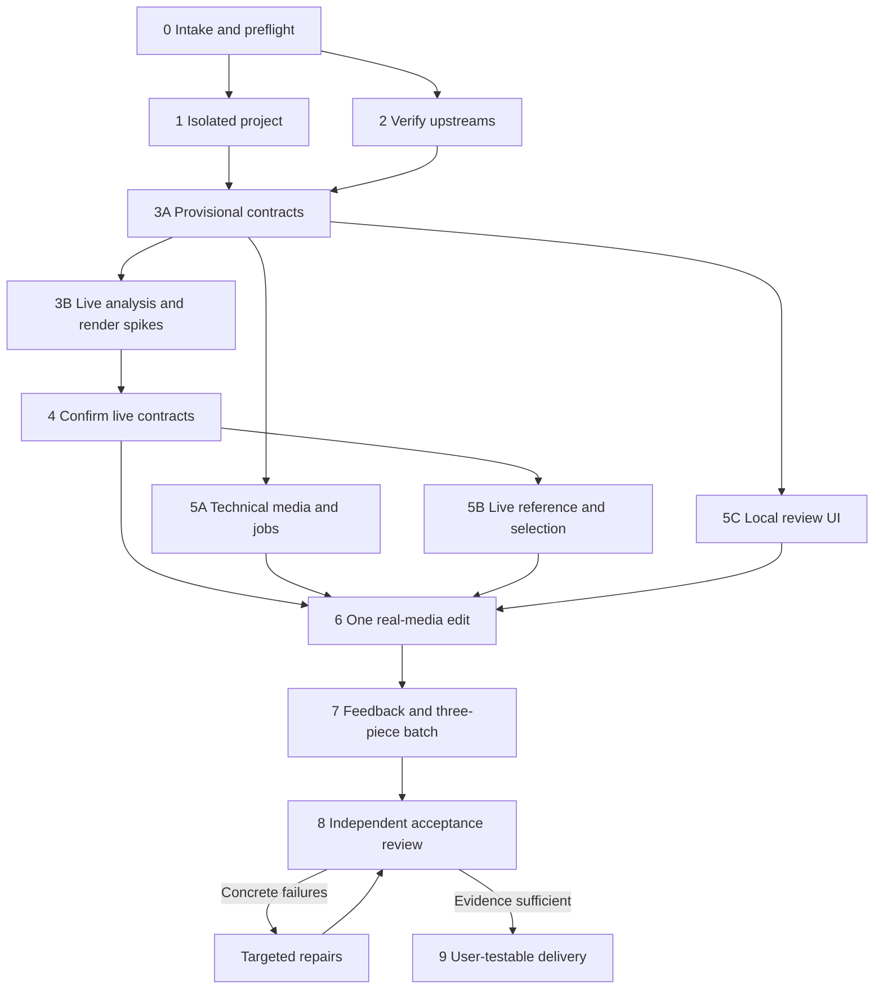

# Build dependency graph

| Task | Owner | Depends on | Completion evidence |
|---|---|---|---|
| 0 Intake/preflight | Orchestrator | — | Product target, media access, processing/spend and required outputs recorded; actual environment inspected |
| 1 Project setup | Orchestrator | 0 | Dedicated writable root, Git isolation, ignore rules and reproducible local environment |
| 2 Upstream verification | Research specialist | 0 | Canonical sources, licenses, resolved versions/interfaces and adoption rationale |
| 3 Provisional interfaces and risk spikes | Integration specialist + orchestrator | 1, 2 | Genuine media analysis and valid source selections; actual render; native round-trip if required |
| 4 Contracts | Orchestrator | 3 | Versioned asset/window/recipe/plan/job/correction schemas |
| 5A Media/render | Media specialist | Provisional contracts; reconcile at 4 | Immutable catalogue, source mapping, cache and deterministic render path |
| 5B Analysis/planning | Selection specialist | 4 | Real reference observations, source-window candidates, constrained selection and coverage gaps |
| 5C UI | UI specialist | Provisional contracts; reconcile at 4 | Actual import, directions, status, evidence and preview/revision controls |
| 6 First vertical slice | Orchestrator | 5A, 5B, 5C | One complete own-footage edit through the UI; no mock semantic path |
| 7 Feedback/batch | Orchestrator + assigned workers | 6 | Persisted scoped correction and rerender; three isolated plans/outputs using cached analysis |
| 8 Review | Independent reviewer | 7 | Acceptance findings with actual evidence; unsupported claims identified |
| 9 Delivery | Orchestrator | 8 and repairs | Reproducible start/test guide, usable app, real outputs, evidence and limits |

The graph expresses dependencies, not a requirement to spawn an agent per node.
After two unresolved targeted repair rounds, reassess. Keep fixing routine defects autonomously; ask Tony only when a consequential choice or changed boundary is necessary.
If footage or model access is pending, provisional contracts allow media/job/UI work and fixtures to continue. Live integration and real-media acceptance remain pending until the actual spikes pass.
